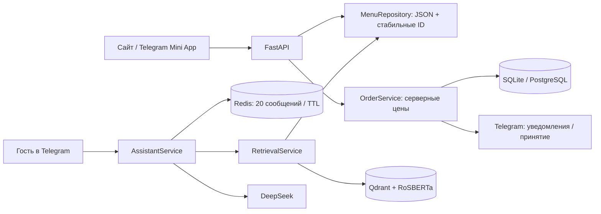

# Pastabar AI

**Меню, онлайн-заказы и двуязычный AI-консультант для ресторана Pasta Bar в Моалбоале.**

React-интерфейс работает как обычный сайт и Telegram Mini App. FastAPI проверяет
заказы, сохраняет их и уведомляет администраторов. Telegram-бот отвечает на вопросы
о меню с помощью retrieval-augmented generation (RAG), а не полагается на знания модели.

## Возможности

- Меню с фотографиями, корзиной и контактами гостя; мобильная адаптация.
- Серверный расчёт стоимости в PHP, стабильные ID блюд, сохранение снимка заказа.
- Админка меню, загрузка изображений и видео-баннера.
- Telegram-уведомления и принятие **конкретного** заказа кнопкой с его ID.
- Русский/английский AI-консультант: Qdrant + RoSBERTa + DeepSeek.
- Поиск по категориям, история диалога, безопасный fallback без ML-инфраструктуры.
- Локальная демонстрация без Telegram-токена, PostgreSQL, Redis и скачивания модели.

## Архитектура



HTTP-маршруты не знают деталей Qdrant или Telegram. Сервисы не зависят от HTTP.
`Runtime` явно управляет жизненным циклом ресурсов. Импорт модулей не скачивает
модель и не открывает сетевые соединения.

```text
pastabar/
  app.py              фабрика приложения, HTTP middleware
  config.py           конфигурация из окружения
  runtime.py          сборка зависимостей и startup/shutdown
  routes/             public/admin HTTP-адаптеры
  menu.py             валидация, ID, атомарное сохранение меню
  orders.py           расчёт стоимости и сценарий оформления
  database.py         долговечные снимки заказов и принятие
  security.py         проверка подписи Telegram
  telegram.py         бот, уведомления, callbacks администраторов
  assistant.py        диалог и обращение к LLM
  retrieval.py        категории, векторный поиск, lexical fallback
  history.py          Redis и ограниченная память для демо
  media.py            загрузки и настройки баннера
frontend/src/
  components/         визуальные блоки
  hooks/              меню, корзина, оформление
  services/           API и необязательный Telegram SDK
  lib/                чистые функции нормализации и проверки
```

## Быстрый запуск без внешних сервисов

Требуются Python **3.11+** (код поддерживает 3.10+) и Node.js **22.12+**.
Команды выполняются из корня репозитория:

```bash
python3 -m venv .venv
source .venv/bin/activate
pip install -e '.[dev]'
# Альтернатива с lockfile: uv sync --frozen --extra dev
cp .env.example .env
# Замените ADMIN_TOKEN на случайный секрет, например:
# openssl rand -hex 32

cd frontend
npm ci
npm run build
cd ..
uvicorn api:app --host 127.0.0.1 --port 8000
```

- Сайт: <http://127.0.0.1:8000/>
- Админка: <http://127.0.0.1:8000/admin.html>
- OpenAPI: <http://127.0.0.1:8000/docs>
- Состояние: <http://127.0.0.1:8000/health>

В деморежиме заказ сохраняется в SQLite, **но не отправляется ресторану**.
`notification_status: pending` означает отсутствие подтверждённой доставки уведомления,
а не потерю заказа. Telegram-бот выключен; модель не скачивается.

При первом старте `instruction.json` копируется в `data/menu.json`, где сохраняются ID.
Дальше приложение читает и редактирует **только `data/menu.json`**. Исходный файл — seed,
не живая база меню. Фото для демо скопируйте один раз:

```bash
mkdir -p data/uploads
cp -n static/images/* data/uploads/
```

### Разработка frontend

В отдельном терминале запустите backend, затем:

```bash
cd frontend
npm run dev
```

Vite проксирует `/api`, `/uploads` и старые `/static/images` на `localhost:8000`.
По умолчанию production API — same-origin. `VITE_API_BASE_URL` нужен только при отдельном
размещении frontend; для такого сценария потребуется явно настроить CORS на backend.

## Настоящий Telegram и RAG

В `.env` включите `TELEGRAM_ENABLED=true`, задайте `TELEGRAM_BOT_TOKEN`, `ADMIN_IDS`,
`WEBAPP_URL` с HTTPS и `DEEPSEEK_API_KEY`. У каждого администратора должен быть начат
диалог с ботом. Для семантического поиска установите `pip install -e '.[rag]'`, задайте
`RAG_ENABLED=true`, `QDRANT_URL` и `QDRANT_API_KEY`. Нужны Redis и Qdrant.

Модель загружается в фоне: сайт и оформление не ждут скачивания весов. До готовности
семантического поиска доступны категории и lexical fallback. `/health` показывает состояние
retrieval (`not_started`, `loading`, `ready`, `degraded`). Подробнее: [архитектура](docs/architecture.md).

## Docker Compose

```bash
cp .env.example .env
# Задайте ADMIN_TOKEN, POSTGRES_PASSWORD и при необходимости ключи интеграций.
mkdir -p data/uploads model_weights
cp -n static/images/* data/uploads/
# Образ работает не от root; bind mounts должны быть доступны UID 10001.
sudo chown -R 10001:10001 data model_weights

docker compose up -d --build
# Локально: http://127.0.0.1:8000
# Production с Caddy (предварительно проверьте домен в Caddyfile):
docker compose --profile production up -d --build
```

Qdrant, Redis и PostgreSQL не публикуются наружу. Меню/медиа находятся в `data/`,
БД — в named volume. Сделайте резервную копию до обновления.

**Существующий сервер нельзя обновлять обычным `git pull && up --build`:** изменились
структура данных, конфигурация и точки монтирования. Есть незакоммиченные серверные
изменения. Сначала выполните [план миграции](docs/deployment.md). Автодеплой отключён:
CI только проверяет код, сборка production запускается отдельно после ревью миграции.

## Проверки

```bash
pip install -e '.[dev]'
ruff check .
ruff format --check .
python3 -m pytest -q
cd frontend
npm run lint
npm test
npm run build
```

Тесты backend не требуют ключей, модели, Redis или Qdrant. Проверяются API, серверные
цены, сохранение заказов при сбое уведомлений, принятие одним администратором,
подписи Telegram, обновление индекса и fallback. Frontend использует Node test runner.
Внешние интеграции в unit-тестах заменены тестовыми реализациями, не live-сервисами.

## API в двух примерах

`GET /api` возвращает только блюда со стабильным верхнеуровневым `id`.

```http
POST /api/create_order
Content-Type: application/json

{"name":"Alex","phone":"@alex","table":"Hotel A","items":[{"id":"<ID из GET /api>","quantity":2}]}
```

Успех: HTTP `201`, `{"status":"ok","order_id":"…","total":"600.00","currency":"PHP",…}`.
Клиент не задаёт цену. В Telegram передаётся заголовок `X-Telegram-Init-Data`; его подпись
и давность проверяются сервером. Без подписи это гостевой заказ, даже если прислать `user_id`.

Админские endpoints требуют `X-Admin-Token`:
`GET/POST /api/admin/menu`, `POST /api/admin/upload`, `POST/DELETE /api/admin/banner`,
`GET /api/admin/orders`. Секрет не вшит в JS, токена по умолчанию нет.

## Границы MVP

Нет оплаты, POS/кухонной интеграции, автоматического бронирования и гарантии доставки
уведомлений. Нет фонового retry/outbox: недоставленные уведомления требуют проверки
администратором через API. При сетевом повторе запроса возможен дубль заказа — нужен
idempotency key. Лимитер однопроцессный и не доверяет forwarded headers; за reverse proxy
ограничение действует на адрес прокси. Для нагрузки нужен edge/shared Redis limiter.
Миграции схемы пока через `create_all`, для эволюции production необходим Alembic.
Состав блюд не является сертифицированной базой аллергенов.

Это приложение для приёма и консультации, а не автономная замена персонала ресторана.
